# PostgreSQL ERD - Phase 2B with Phase 2C operation header

Phase 2C adds the operation header and posting services; deployment and full audit closing remain pending. See [Phase 2C engine](phase2c-transaction-engine.md). Default Django table names; abbreviated fields. All business PKs are bigint. Rack/Shelf/Bin are StorageLocation kinds. See [architecture](database-architecture.md) for constraints.

```mermaid
erDiagram
    auth_user }o--o{ auth_group : membership
    auth_group }o--o{ auth_permission : grants
    auth_user }o--o{ auth_permission : direct_grants
    inventory_assetcategory ||--o{ inventory_productmodel : classifies
    inventory_manufacturer o|--o{ inventory_productmodel : makes
    inventory_productmodel ||--o{ inventory_asset : serialized
    inventory_productmodel ||--o{ inventory_stockbalance : bulk
    inventory_productmodel o|--o{ inventory_assetspecification : catalog_owner
    inventory_asset o|--o{ inventory_assetspecification : unit_owner
    inventory_specificationdefinition ||--o{ inventory_assetspecification : defines
    warehouse_warehouse ||--o{ warehouse_storagelocation : contains
    warehouse_storagelocation o|--o{ warehouse_storagelocation : parent
    warehouse_storagelocation o|--o{ inventory_asset : current_position
    warehouse_storagelocation ||--o{ inventory_stockbalance : stores
    warehouse_warehouse ||--o{ inventory_stockthreshold : scope
    inventory_productmodel ||--o{ inventory_stockthreshold : threshold
    inventory_asset o|--o{ transactions_stockmovement : asset_subject
    inventory_productmodel o|--o{ transactions_stockmovement : bulk_subject
    warehouse_storagelocation o|--o{ transactions_stockmovement : source
    warehouse_storagelocation o|--o{ transactions_stockmovement : destination
    inventory_stockbalance o|--o{ transactions_stockmovement : debit
    inventory_stockbalance o|--o{ transactions_stockmovement : credit
    transactions_stockoperation ||--o{ transactions_stockmovement : trigger_enforced_operation_key
    auth_user ||--o{ transactions_stockoperation : requests
    auth_user o|--o{ transactions_stockoperation : approves
    transactions_stockmovement o|--o{ transactions_stockmovement : reverses
    auth_user ||--o{ transactions_stockmovement : posts
    inventory_asset ||--o{ transactions_assetassignment : custody
    accounts_assetrecipient ||--o{ transactions_assetassignment : recipient
    auth_user o|--o| accounts_assetrecipient : optional_person_login
    auth_user ||--o{ transactions_assetassignment : issued_by
    auth_user o|--o{ transactions_assetassignment : returned_by
    transactions_stockmovement ||--o| transactions_assetassignment : issue
    transactions_stockmovement o|--o| transactions_assetassignment : return
    warehouse_storagelocation ||--o{ audits_physicalinventoryaudit : scope
    auth_user ||--o{ audits_physicalinventoryaudit : performs
    auth_user o|--o{ audits_physicalinventoryaudit : approves
    audits_physicalinventoryaudit ||--o{ audits_auditline : contains
    inventory_asset o|--o{ audits_auditline : asset_subject
    inventory_productmodel o|--o{ audits_auditline : bulk_subject
    inventory_stockbalance o|--o{ audits_auditline : snapshot_bucket
    warehouse_storagelocation ||--o{ audits_auditline : observed_or_searched
    warehouse_storagelocation o|--o{ audits_auditline : expected
    auth_user o|--o{ audits_auditline : counts
    audits_auditline o|--o{ transactions_stockmovement : correction
    inventory_asset o|--o{ audits_assetchangelog : context
    auth_user ||--o{ audits_assetchangelog : records
    auth_user ||--o{ inventory_importbatch : uploads
    auth_user o|--o{ inventory_importbatch : reviews
    inventory_importbatch ||--o{ inventory_importstagingrecord : captures
    inventory_asset o|--o{ inventory_importstagingrecord : asset_target
    inventory_stockbalance o|--o{ inventory_importstagingrecord : bulk_target
    inventory_importstagingrecord o|--o| transactions_stockmovement : opening_receipt

    inventory_assetcategory {
        bigint id PK
        varchar code UK
    }
    inventory_manufacturer {
        bigint id PK
        varchar code UK
    }
    inventory_productmodel {
        bigint id PK
        varchar sku_code UK
        bigint category_id FK
        bigint manufacturer_id FK
        varchar tracking_mode
        bigint capacity_bytes
    }
    inventory_specificationdefinition {
        bigint id PK
        varchar code UK
        varchar data_type
    }
    inventory_assetspecification {
        bigint id PK
        bigint definition_id FK
        bigint product_model_id FK
        bigint asset_id FK
        bigint integer_value
        decimal decimal_value
        text text_value
        boolean boolean_value
    }
    inventory_asset {
        bigint id PK
        varchar asset_tag UK
        bigint product_model_id FK
        varchar serial_raw
        varchar condition
        varchar lifecycle_status
        bigint current_location_id FK
    }
    inventory_stockbalance {
        bigint id PK
        bigint product_model_id FK
        bigint location_id FK
        varchar condition
        varchar stock_state
        bigint quantity
    }
    inventory_stockthreshold {
        bigint id PK
        bigint product_model_id FK
        bigint warehouse_id FK
        bigint minimum_quantity
    }
    warehouse_warehouse {
        bigint id PK
        varchar code UK
    }
    warehouse_storagelocation {
        bigint id PK
        bigint warehouse_id FK
        bigint parent_id FK
        varchar code
        varchar kind
    }
    transactions_stockoperation {
        uuid operation_key PK
        jsonb request
        varchar fingerprint
        bigint requested_by_id FK
        timestamptz requested_at
        bigint approved_by_id FK
        timestamptz approved_at
        text approval_reason
        timestamptz posted_at
    }
    transactions_stockmovement {
        bigint id PK
        uuid public_id UK
        uuid operation_key
        integer line_number
        bigint asset_id FK
        bigint product_model_id FK
        bigint source_location_id FK
        bigint destination_location_id FK
        bigint source_balance_id FK
        bigint destination_balance_id FK
        bigint actor_id FK
        bigint audit_line_id FK
        bigint import_row_id FK,UK
        bigint reverses_id FK
        bigint quantity
        timestamptz occurred_at
        timestamptz recorded_at
    }
    transactions_assetassignment {
        bigint id PK
        bigint asset_id FK
        bigint recipient_id FK
        text destination_description
        varchar destination_reference
        bigint issued_by_id FK
        bigint returned_by_id FK
        bigint issue_movement_id FK,UK
        bigint return_movement_id FK,UK
        timestamptz assigned_at
        timestamptz returned_at
    }
    audits_physicalinventoryaudit {
        bigint id PK
        uuid public_id UK
        bigint scope_location_id FK
        bigint performed_by_id FK
        bigint approved_by_id FK
        varchar status
    }
    audits_auditline {
        bigint id PK
        bigint audit_id FK
        bigint asset_id FK
        bigint product_model_id FK
        bigint stock_balance_id FK
        bigint expected_location_id FK
        bigint location_id FK
        bigint counted_by_id FK
        bigint expected_quantity
        bigint observed_quantity
    }
    audits_assetchangelog {
        bigint id PK
        uuid public_id UK
        varchar entity_kind
        bigint entity_pk
        bigint asset_id FK
        bigint actor_id FK
        jsonb before
        jsonb after
        uuid operation_key
    }
    inventory_importbatch {
        bigint id PK
        uuid public_id UK
        varchar file_sha256
        bigint uploaded_by_id FK
        bigint reviewed_by_id FK
        varchar status
    }
    inventory_importstagingrecord {
        bigint id PK
        bigint batch_id FK
        varchar worksheet_name
        integer excel_row_number
        jsonb raw_values
        jsonb validation_errors
        bigint asset_id FK
        bigint stock_balance_id FK
    }
    accounts_assetrecipient {
        bigint id PK
        varchar code UK
        varchar name
        varchar kind
        integer user_id FK,UK
        varchar external_reference
        boolean is_active
    }
    auth_user {
        integer id PK
        varchar username UK
    }
    auth_group {
        integer id PK
        varchar name UK
    }
    auth_permission {
        integer id PK
        varchar codename
    }
```

Existing auth_user_groups, auth_user_user_permissions and auth_group_permissions join tables implement the displayed many-to-many relationships. Framework PKs retain their existing types. No custom role table.

XOR rules are additional constraints: movement asset versus bulk product; specification catalog versus asset owner; promoted staging asset versus balance. ImportStagingRecord's opening movement is the reverse relation from StockMovement.import_row, not a second FK.

Relationship summary: warehouse -> location tree -> assets/bulk buckets; category/manufacturer -> catalog -> individually tracked units or bulk positions; movement ledger -> positions/custody; audit snapshots -> approved corrections; source batch -> staging row -> target and opening movement; immutable change events -> actor and stable entity identity. Recipient may have no login account; assignment destination describes a hostname, department or work order.

Exact fields and indexes: [model reference](phase2b-model-reference.md). Constraint/trigger versus clean()-only boundaries: [architecture](database-architecture.md). The diagram does not imply that ledger posting, audit freeze or cross-row custody coherence is implemented.

Phase 2C movement/header relation is trigger-enforced, not a new physical FK; complete-operation/count/identity guards and immutable header history enforce the relationship. Earlier final Phase 2B enforcement caveats are superseded only where documented in the Phase 2C matrix.
